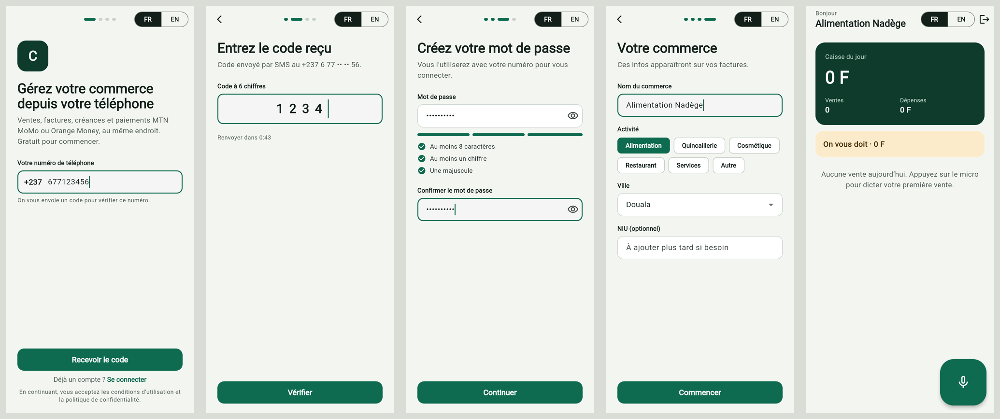
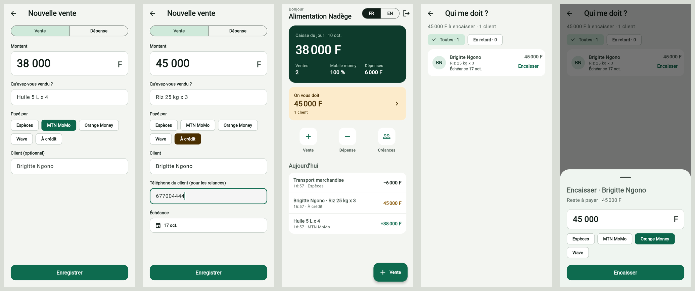

# Caisso

Application mobile de gestion pour commerçants et PME au Cameroun : ventes, factures,
créances et encaissements MTN MoMo / Orange Money. Flutter, Android d'abord.





## État actuel

- Inscription en 4 étapes : téléphone (+237), code SMS, mot de passe, infos du commerce.
- Connexion par numéro et mot de passe.
- Accueil : caisse du jour (argent réellement encaissé), part du mobile money, dépenses,
  total des créances et opérations du jour, mis à jour en direct.
- Saisie d'une vente (espèces, MTN MoMo, Orange Money, Wave ou à crédit avec client et
  échéance) et d'une dépense.
- Créances : liste « Qui me doit ? », filtre des retards, encaissement total ou partiel.
- Tout est enregistré sur le téléphone (SQLite via drift) et fonctionne sans connexion.
- Interface en français et en anglais (bouton FR / EN).

Le backend n'existe pas encore : `FakeAuthRepository` simule le serveur en mémoire.
**En développement, le code SMS est toujours `123456`.**

## Lancer le projet

```bash
flutter pub get
flutter run            # sur un téléphone Android branché ou un émulateur
flutter run -d chrome  # dans le navigateur
flutter test
flutter analyze
```

## Organisation du code

```
lib/
  main.dart, app.dart          point d'entrée, routes (go_router), thème, langue
  core/                        thème, textes FR/EN, validations, format des montants
  data/                        base locale (drift) : clients, ventes, paiements, dépenses
  features/
    auth/
      data/                    contrat avec le backend + implémentation factice
      application/             logique de l'inscription et de la connexion (Riverpod)
      presentation/            écrans et composants
    home/                      écran d'accueil
    ledger/                    saisie des ventes et dépenses, créances
test/                          tests unitaires et tests d'écran
```

Après une modification de `lib/data/database.dart`, régénérer le code :

```bash
dart run build_runner build
```

`web/sqlite3.wasm` et `web/drift_worker.js` servent à la version web ; ils doivent
correspondre aux versions de `sqlite3` (3.5.2) et `drift` (2.35.2) du `pubspec.lock`.

## Comment sont calculés les chiffres

- Une vente payée crée la vente et un paiement du même montant.
- Une vente à crédit crée la vente sans paiement ; chaque encaissement ajoute un paiement.
- **Caisse du jour** = somme des paiements reçus ce jour-là (une créance soldée compte le
  jour où l'argent arrive, pas le jour de la vente).
- **Créance** = montant de la vente moins la somme de ses paiements.

## Prochaines étapes

1. Facture PDF et envoi par WhatsApp, relances des créances.
2. Saisie vocale d'une vente.
3. Backend : API, envoi des SMS, mots de passe hachés côté serveur, agrégateur de paiement MTN / Orange.
